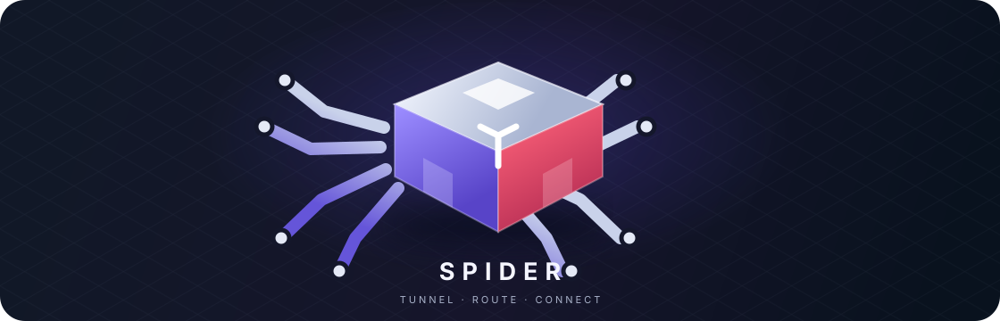

 

**A cross-platform VPN and proxy client**  ·  **کلاینت چندسکویی VPN و پراکسی**

[English](#english) · [فارسی](#فارسی)

 

---

## English

Spider brings VPN tunnels, proxy profiles, subscriptions, and traffic routing into one app for Android and desktop. Import a link or configuration, choose how traffic is routed, and connect through the engine that supports that profile.

### Protocols and configuration formats

**VLESS · VMess · Trojan · Shadowsocks · SOCKS4/4a/5 · HTTP/HTTPS · WireGuard · AmneziaWG · Hysteria/Hysteria 2 · MASQUE**

Spider also imports supported **sing-box and Xray JSON configurations** and compatible share links, including **TUIC, AnyTLS, NaiveProxy, and Snell** through sing-box.

### Included tunnel engines and services

- **Aether** tunnels: WireGuard, MASQUE, GOOL, MIM, and WireGuard over MASQUE.
- **SSH, IKEv2, OpenConnect, Psiphon, Tor, and DNS tunnels.**
- **VeePN and Firefox VPN** account and location integrations.
- **MHR and Soar** profiles on desktop.
- Optional SNI spoofing for supported VLESS configurations.

Manage subscriptions and profiles, use global or Iran-bypass routing, and share a local SOCKS proxy over your LAN. Available options depend on the platform and the selected engine.

### Platforms

| Platform | Availability |
| --- | --- |
| Android | Supported |
| Linux | Supported |
| Windows | Supported |
| macOS | Supported |

### Project origin

Spider is a fork of **ZedSecure**, continued and adapted as Spider.

## فارسی

Spider یک کلاینت چندسکویی برای مدیریت تونل‌های VPN، پروفایل‌های پراکسی، سابسکریپشن‌ها و مسیریابی ترافیک است. لینک یا فایل پیکربندی را وارد کنید، روش مسیریابی را انتخاب کنید و با موتور سازگار به سرور وصل شوید.

### پروتکل‌ها و قالب‌های پیکربندی

**VLESS · VMess · Trojan · Shadowsocks · SOCKS4/4a/5 · HTTP/HTTPS · WireGuard · AmneziaWG · Hysteria/Hysteria 2 · MASQUE**

همچنین پیکربندی‌های **sing-box و Xray با قالب JSON** و لینک‌های سازگار، از جمله **TUIC، AnyTLS، NaiveProxy و Snell** از طریق sing-box پشتیبانی می‌شوند.

### موتورهای تونل و سرویس‌ها

- تونل‌های **Aether**: ‏WireGuard، ‏MASQUE، ‏GOOL، ‏MIM و WireGuard روی MASQUE.
- **SSH، ‏IKEv2، ‏OpenConnect، ‏Psiphon، ‏Tor و تونل DNS.**
- اتصال حساب و انتخاب لوکیشن برای **VeePN و Firefox VPN**.
- پروفایل‌های **MHR و Soar** در نسخهٔ دسکتاپ.
- امکان SNI Spoofing برای پیکربندی‌های سازگار VLESS.

پروفایل‌ها و سابسکریپشن‌ها را مدیریت کنید، مسیریابی Global یا دور زدن ترافیک ایران را انتخاب کنید و پراکسی SOCKS را در شبکهٔ محلی به‌اشتراک بگذارید. گزینه‌های در دسترس به پلتفرم و موتور انتخاب‌شده بستگی دارند.

### پلتفرم‌ها

Android، Linux، Windows و macOS.

### خاستگاه پروژه

Spider فورکی از **ZedSecure** است که توسعه و برای پروژهٔ Spider سازگار شده است.

---

Made with care for an open internet · ساخته‌شده برای دسترسی آزاد و پایدار

